<!-- wth-lg's profile README. assets/build.py draws the images in assets/; scripts/daily.py draws stats.svg and restyles the
     3D calendar every day (.github/workflows/profile-3d.yml). The design is wentao.gg's: Space Grotesk and JetBrains Mono,
     ink, paper and one blue, a 100 ms beat (build.py's docstring). Nothing here repeats wentao.gg or GitHub's own profile.
     Under 600 px each image has a -narrow source, 480 wide, so its type stays readable on a phone. -->

<a href="https://wentao.gg"><picture><source media="(max-width: 600px)" srcset="https://raw.githubusercontent.com/wth-lg/wth-lg/main/assets/banner-narrow.svg" /></picture></a>

  <a href="https://wentao.gg"><picture><source media="(max-width: 600px)" srcset="https://raw.githubusercontent.com/wth-lg/wth-lg/main/assets/link-site-narrow.svg" /></picture></a>&nbsp;
  <a href="https://www.linkedin.com/in/wthe/"><picture><source media="(max-width: 600px)" srcset="https://raw.githubusercontent.com/wth-lg/wth-lg/main/assets/link-linkedin-narrow.svg" /></picture></a>&nbsp;
  <a href="mailto:me@wentao.gg"><picture><source media="(max-width: 600px)" srcset="https://raw.githubusercontent.com/wth-lg/wth-lg/main/assets/link-email-narrow.svg" /></picture></a>

<picture><source media="(max-width: 600px)" srcset="https://raw.githubusercontent.com/wth-lg/wth-lg/main/assets/h-about-narrow.svg" /></picture>
<a href="https://wentao.gg"><picture><source media="(max-width: 600px)" srcset="https://raw.githubusercontent.com/wth-lg/wth-lg/main/assets/about-narrow.svg" /></picture></a>

<picture><source media="(max-width: 600px)" srcset="https://raw.githubusercontent.com/wth-lg/wth-lg/main/assets/h-stack-narrow.svg" /></picture>
<picture><source media="(max-width: 600px)" srcset="https://raw.githubusercontent.com/wth-lg/wth-lg/main/assets/stack-narrow.svg" /></picture>

<picture><source media="(max-width: 600px)" srcset="https://raw.githubusercontent.com/wth-lg/wth-lg/main/assets/h-activity-narrow.svg" /></picture>
<!-- stats -->
<picture>
  <source media="(max-width: 600px)" srcset="https://raw.githubusercontent.com/wth-lg/wth-lg/main/assets/stats-narrow.svg" />
  
</picture>
<!-- /stats -->
<picture>
  <source media="(prefers-color-scheme: dark)" srcset="https://raw.githubusercontent.com/wth-lg/wth-lg/main/profile-3d-contrib/profile-night-view.svg" />
  <source media="(prefers-color-scheme: light)" srcset="https://raw.githubusercontent.com/wth-lg/wth-lg/main/profile-3d-contrib/profile-green.svg" />
  
</picture>

<picture><source media="(max-width: 600px)" srcset="https://raw.githubusercontent.com/wth-lg/wth-lg/main/assets/footer-narrow.svg" /></picture>

